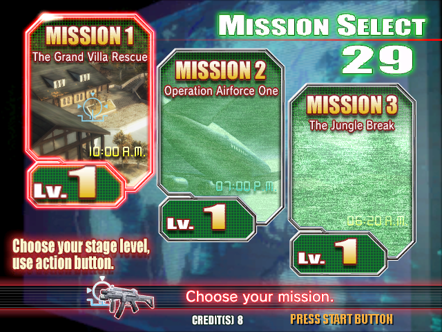
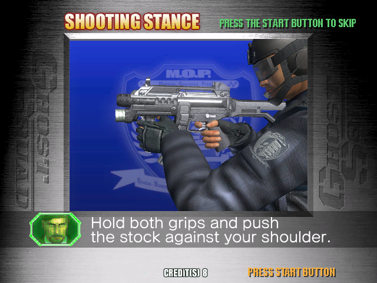
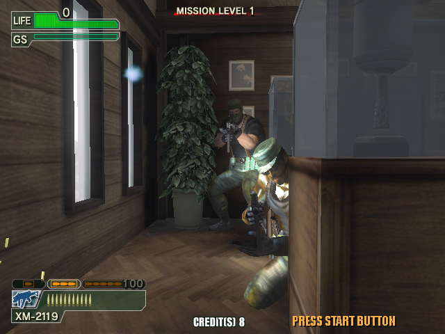
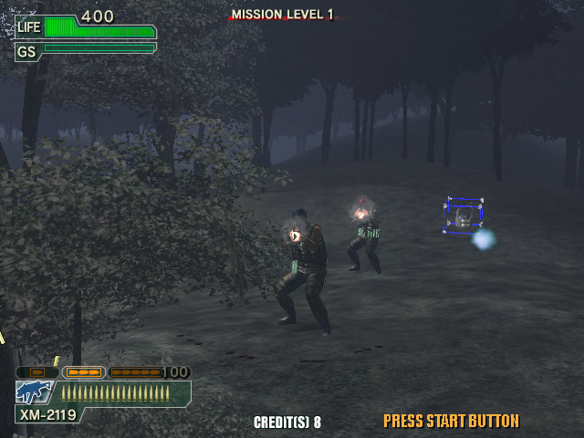
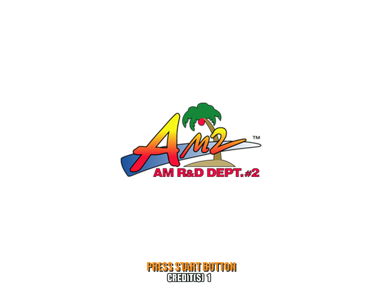

# ghostsquadevolution-lindbergh-recomp

**Ghost Squad Evolution (Sega, 2007) — a Lindbergh light-gun shooter,
statically recompiled from its x86 ELF to native C.**

Built on [**lindberghrecomp**](https://github.com/sp00nznet/lindberghrecomp),
the Sega Lindbergh recompilation toolkit, vendored here as a git submodule. It
shares the house style of sp00nznet's other recomp projects.

> **This fork adds a native macOS port** (Apple Silicon): an SDL2 window,
> OpenGL through the macOS driver, the game's own sound through OpenAL, the
> mouse as the gun, and a menu bar for controls, aim, sound and language. To
> build it from your own copy of the game, see
> [Quick start (macOS)](#quick-start-macos). It is one script. Upstream is
> [sp00nznet/ghostsquadevolution-lindbergh-recomp](https://github.com/sp00nznet/ghostsquadevolution-lindbergh-recomp).

> **No game data here.** No ELF, no disc, no filesystem image, no keys. The
> `.gitignore` refuses all of it — including the game binary itself, which has
> no extension and so slipped past an extension list once already. Bring a
> game tree you can already read; the recompiled C is output you generate, and
> it is never distributed.

**[Join the sp00nznet recomp Discord](https://discord.gg/CRpzGWZFcu)**

### Why this one

It is the cleanest target on the platform, which is not obvious until you read
what it links against.

Most of the work on *Let's Go Jungle* went into things this game does not have.
It wants no Cg, no `XF86VidMode`, and — remarkably for a Sega arcade title —
**none of SEGA's own libraries**. No `libsegaapi`, no `amLib`, so no base
board, no security dongle, no JVS packet protocol standing between it and its
first frame. Its entire platform surface is GLUT, GL/GLU, X11, pthread, libc,
ncurses and zlib.

It is also the smallest: 6,033 functions against Let's Go Jungle's 31,759.

The one thing it does need that the toolkit has never had is **GLUT**. That is
not a small detail — GLUT inverts control. A game registers callbacks and hands
its loop to the toolkit, where *Let's Go Jungle* drives its own loop and calls
swap when it pleases. This game calls `glutMainLoop`, which never returns, so
the runtime's handler has to *become* the loop and call back into lifted code.

Three of the Lindbergh titles checked so far are GLUT-based and only two are
not, so that seam is worth building once and is why this game is next.

## Status

**Alpha, unreleased.** It boots, renders, and takes a coin, then dies in the
I/O loop after a few hundred frames. The [changelog](CHANGELOG.md) says what
changed, and the [roadmap](ROADMAP.md) says what is next.

**On macOS (this fork)** the game does not die. It runs at a steady 60 fps
through boot, attract and play. Coin, start, the gun, reload and the grenade
launcher all work, and so does sound. The table and the failure below are the
Windows build.

| | |
|---|---|
|  |  |
|  |  |

*On an M-series Mac, at the game's own 640x480.*



| | |
|---|---|
| Lifts | 6,033 functions, 379,487 instructions, **99.975%** |
| Builds | clean, first try |
| Window and GL context | yes, at the 640x480 the game asks for |
| GLUT loop and callbacks | yes, all twelve |
| Boot sequence | developer logo, coin, start, SEGA warning screen |
| Input | coin, start, trigger and gun all reach the game |
| Runs indefinitely | **no** — dies after a few hundred frames |

It gets through CRT start up, its own heap manager, GLUT setup, and into its
boot sequence. A coin registers (`CREDIT(S) 1`), start is accepted, and it
reaches the SEGA warning screen. Then, several hundred frames later, the
process disappears.

### What the failure is, and is not

The exit code is `0xC0000409` — a Windows fail-fast. That is raised through
`__fastfail`, which the kernel handles directly: no vectored exception
handler runs, no `atexit` hook runs, and nothing is printed. From the outside
it is indistinguishable from the process being switched off.

Ruled out, each by measurement rather than argument:

| | how |
|---|---|
| the game calling `exit()` | bound and logged; never fires |
| an unlifted instruction | `RECOMP_TODO` reports and exits 44; never fires |
| a CRT invalid parameter | handler installed, and **proven to fire** on a different fault |
| `abort()` | `_CALL_REPORTFAULT` cleared so it becomes a catchable `SIGABRT`; never fires |
| a pure virtual call, or an exception unwinding | both bound to report; neither fires |
| the analog report | `LINDBERGH_NO_GUN=1` pins the gun centred; no change |
| `qsort` writing out of bounds | logged: 13 elements of 4 bytes, and bounded anyway |
| stubbed library objects overlapping | each symbol now gets its own 256 KB; no change |
| a different JVS packet layout to the first game | `amJvspClearPacket` is byte-identical in both |
| a different backup wrapper argument order | identical in both |
| stale object files after a header change | full clean rebuild; no change |

What is left is host-side memory corruption: something writes over the host's
own stack, and `/GS` notices at the next return. The dispatch ring - which is
flushed to disc precisely because this failure leaves nothing behind - puts
the last calls in the JVS polling loop both with and without a coin inserted,
which is where the runtime's own code runs most often rather than necessarily
where the fault is.

The next step is a debugger. In-process approaches have all been tried.

## Quick start (macOS)

An Apple Silicon Mac. You bring the game. This repo has none of it.

1. **Install the tools.**
   ```sh
   xcode-select --install          # compiler and the macOS SDK, once
   brew install cmake ninja sdl2 python@3.11
   ```
2. **Have your game folder ready.** That is `vsg_l/`, holding `vsg` (the ELF,
   no extension), `snd_util.so` and `librnalindbergh_jr.so`. Pointing the
   script at the disc root that contains `vsg_l/` or `disk1/vsg_l/` works too.
3. **Clone, build, run.**
   ```sh
   git clone --recursive -b macos-port https://github.com/lialan/ghostsquadevolution-lindbergh-recomp
   cd ghostsquadevolution-lindbergh-recomp
   ./scripts/build-macos.sh /path/to/vsg_l     # about 30 s; makes build-mac/ghostsquadevolution
   ./scripts/run-macos.sh   /path/to/vsg_l
   ```
   A 640x480 window opens on the developer logo. It starts **muted**: press `M`
   for sound.

`build-macos.sh` can be run again whenever you like. It re-lifts, keeps every
file that came out the same, and rebuilds only what changed. The binary it
makes is yours: it is compiled from your copy of the game, which is why none
is published here.

### What the script does

The same thing by hand, from the repo root, in a venv that has
`capstone` and `pyelftools`:

```sh
GAME=/path/to/vsg_l
GEN=$PWD/games/ghostsquadevolution/generated
GL=$(xcrun --show-sdk-path)/System/Library/Frameworks/OpenGL.framework/Headers
cd lindberghrecomp
python -m tools recomp "$GAME/vsg" "$GEN"                       # 6033 functions, 298 imports
python -m tools.recomp.solib "$GEN" "$GAME/librnalindbergh_jr.so" "$GAME/snd_util.so"
python tools/gen_gl_thunks.py "$GEN/recomp_imports.h" "$GL/gl.h" "$GL/glext.h" > "$GEN/recomp_gl_thunks.c"
cd ..
cmake -S . -B build-mac -G Ninja -DCMAKE_BUILD_TYPE=RelWithDebInfo
cmake --build build-mac
cd "$GAME" && /path/to/repo/build-mac/ghostsquadevolution vsg
```

The game dlopens its two sound libraries. `solib.py` links them ahead of time
at fixed guest addresses and lifts them like the main ELF. Their order on that
command line decides those addresses, so keep it as written.

### macOS controls and switches

The keys are the cabinet's (see [Usage](#usage)), plus:

* `M` toggles sound. `LINDBERGH_MUTE=0` starts with it on.
* `F` is the gun's fire-mode selector (the grenade launcher).
* The menu bar has controls, aim calibration, sound and language (English by
  default). Settings are saved to `lindbergh.ini` in the game's folder.

Trip-ups:
* **`missing: ...`**: the script names the Homebrew packages to install.
* **`no 'vsg' in ...`**: point it at the folder that holds `vsg`, not at `vsg`
  itself.
* **Link errors naming `L_B4...` or `recomp_solib`**: the sound libraries were
  not lifted. Run `build-macos.sh` again rather than lifting by hand.

## Getting Started (Windows)

There is no one-click setup yet (see the [roadmap](ROADMAP.md)). These steps
take a clean Windows machine to the SEGA warning screen.

1. **Install the prerequisites.**
   * [Python 3.11](https://www.python.org/downloads/). Use `py -3.11`, not
     `python`: on a fresh Windows, `python` can open the Microsoft Store instead.
   * Visual Studio 2022 (Community is enough) with **Desktop development with
     C++**. It includes the 32-bit MSVC toolchain and CMake 3.20 or newer.
   * Git, and an OpenGL GPU driver.
2. **Have a readable game tree.** The game is `disk1\vsg_l\vsg`, an ELF with no
   extension. This project does not decrypt discs.
3. **Clone with the toolkit and install capstone.**
   ```powershell
   git clone --recursive https://github.com/sp00nznet/ghostsquadevolution-lindbergh-recomp
   cd ghostsquadevolution-lindbergh-recomp
   py -3.11 -m pip install capstone
   ```
4. **Lift the game to C.** The output goes to the gitignored
   `games\ghostsquadevolution\generated\`. Expected output:
   ```
   > cd lindberghrecomp
   > py -3.11 -m tools recomp D:\gse\disk1\vsg_l\vsg ..\games\ghostsquadevolution\generated
   [*] 6033 functions in 16 translation units, 298 imports
   lifted 6033 functions, 298 distinct imports -> ..\games\ghostsquadevolution\generated
   > cd ..
   ```
5. **Build.** See [Building from source](#building-from-source). This gives you
   `build\Release\ghostsquadevolution.exe`.
6. **Run it from inside the game's directory**, as the cabinet's launcher does.
   It needs no `TEA_DIR`.
   ```powershell
   cd D:\gse\disk1\vsg_l
   C:\path\to\ghostsquadevolution-lindbergh-recomp\build\Release\ghostsquadevolution.exe vsg
   ```
   A 640x480 window opens and shows the developer logo. `5` inserts a coin.

Trip-ups:
* **`no lifted code ... building the toolkit self-check only`** at configure
  time means step 4 didn't write into `games\ghostsquadevolution\generated`.
* **A CMake error about a 64-bit build** means `-A Win32` was left off.
* **`pcrecomp submodule is missing`** means the clone wasn't recursive. Run
  `git submodule update --init --recursive`.

## Usage

The cabinet is a keyboard and mouse: `5`/`6` insert a coin for player one/two,
`1`/`2` start, `T` test, `S` service. The mouse aims the gun, left click is the
trigger, and right click reloads.

```powershell
# what the game asks the board for (run from lindberghrecomp\)
py -3.11 -m tools elf D:\gse\disk1\vsg_l\vsg

# pin the gun to the centre of the screen
$env:LINDBERGH_NO_GUN = 1
```

The runtime switches are documented in
[the toolkit](https://github.com/sp00nznet/lindberghrecomp/blob/main/docs/instruments.md).

## Building from source

```powershell
cmake -S . -B build -A Win32
cmake --build build --config Release
```

The build has to be 32-bit, because the game maps at `0x08048000`. Without
lifted code, the same commands build the toolkit's self-check only. That is
what CI does on every push, since CI has no game. The full build also runs on
netlab (`netlab check ghostsquadevolution-lindbergh-recomp`).

## Layout

```
lindberghrecomp/                    the toolkit (git submodule)
scripts/build-macos.sh              lift your game and build it on macOS
scripts/run-macos.sh                start it from the game's folder
games/ghostsquadevolution/
  src/host.c                        load the ELF, enter it, get out of the way
  generated/                        the lifted C (you generate it; gitignored)
```

## License

The host and the recompilation toolchain are original work, MIT-licensed.
**No game data, no disc images, no keys, and no circumvention of anything.**
*Ghost Squad Evolution* is © Sega; this is an independent, non-commercial
preservation project. Built on
[**lindberghrecomp**](https://github.com/sp00nznet/lindberghrecomp).

## Contributors

No outside contributions yet. To help, read
[CONTRIBUTING.md](CONTRIBUTING.md) first.
