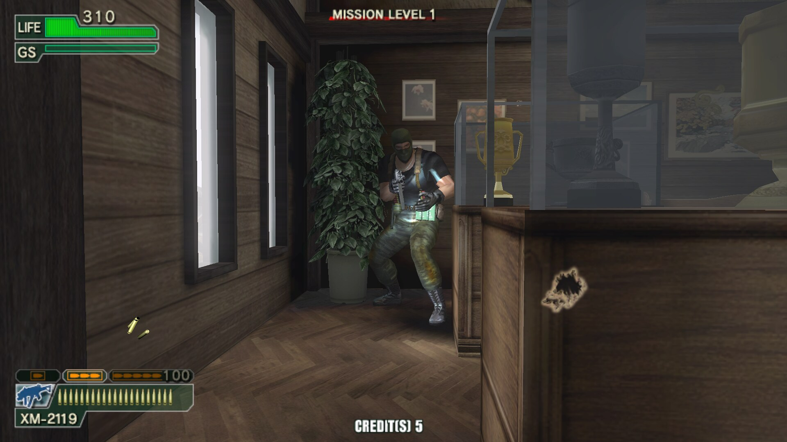
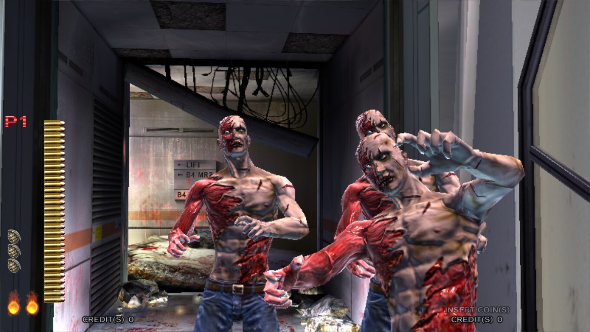
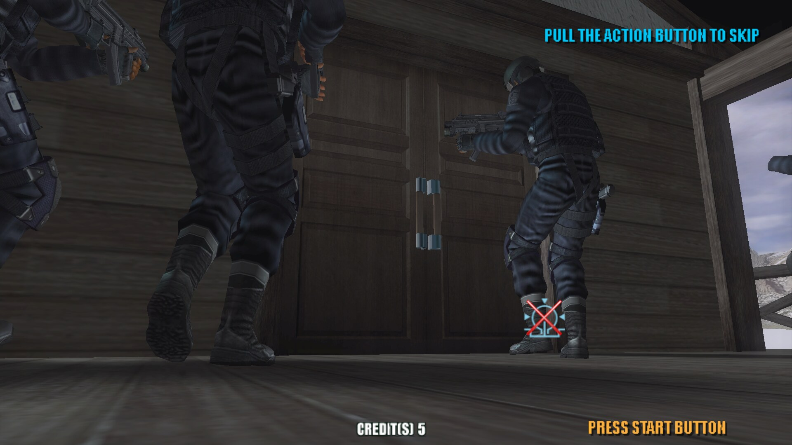
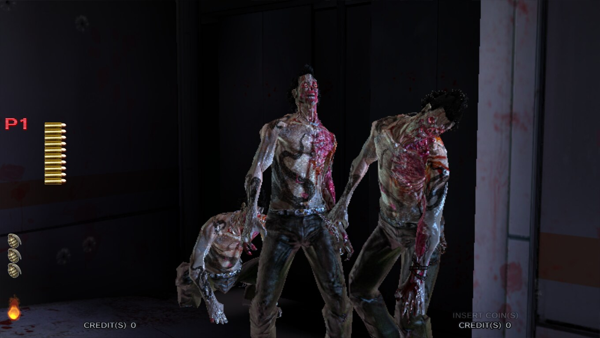
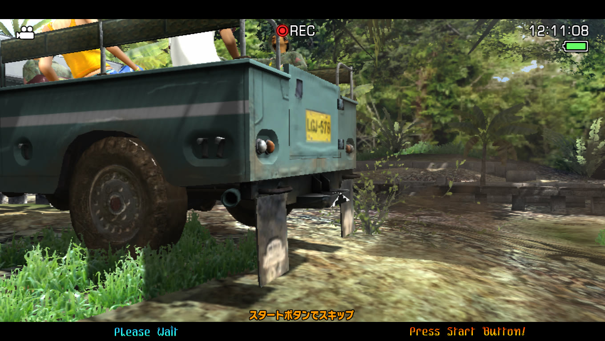
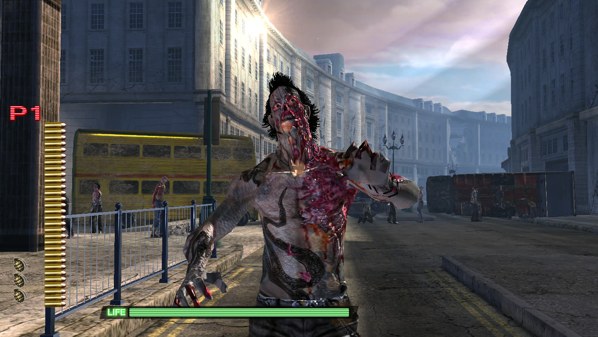
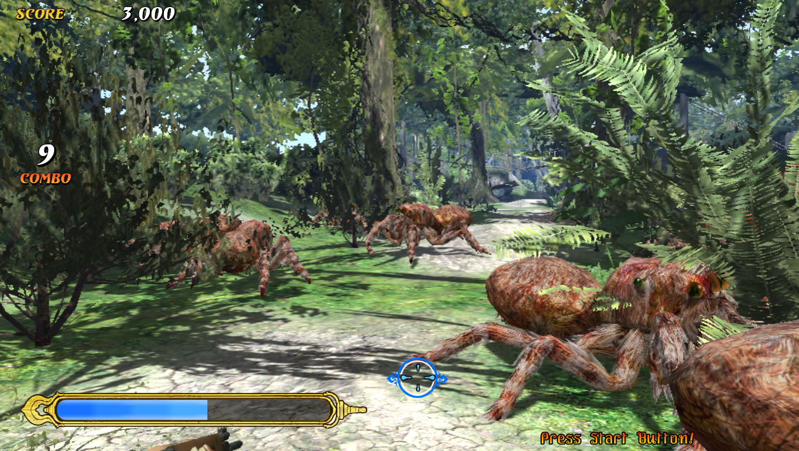
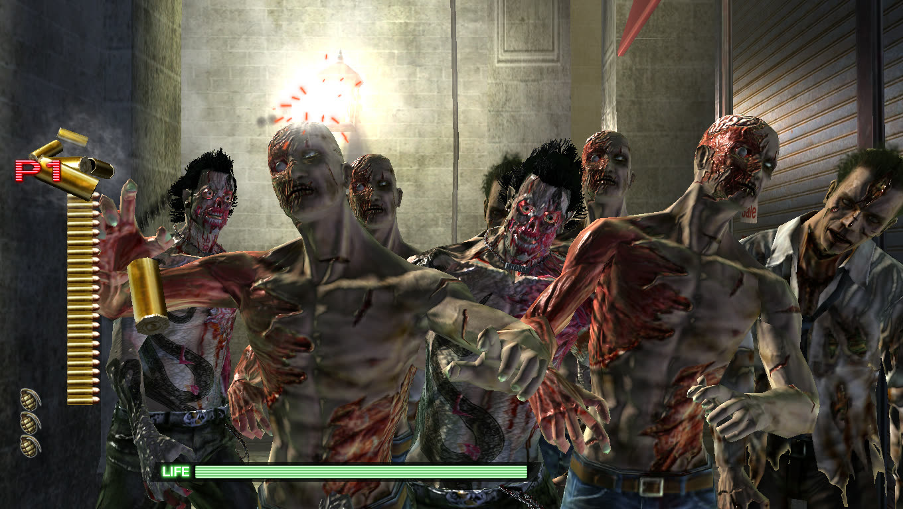

# lindbergh-recomp-ports

**Sega Lindbergh arcade games, statically recompiled from their x86 Linux
executables to native code: on macOS, and standalone in VR on Meta Quest.**

Each game's code is lifted to C by
[**lindberghrecomp**](https://github.com/sp00nznet/lindberghrecomp) and built
against its runtime, which stands in for the cabinet: its GL, sound, gun and
board. Nothing is emulated. Four games so far; more will follow, each in its
own folder under `games/`.

> **No game data here.** No executables, no discs, no filesystem images, no
> keys, and not the lifted C either. The `.gitignore` refuses all of it.
> Bring your own copy of the game; the build lifts it on your machine. (The
> Quest release APKs carry a game's code, compiled, but none of its files.)

## Thank you, sp00nznet

This project is a fork of
[**sp00nznet**](https://github.com/sp00nznet)'s work, and it would not exist
without it. sp00nznet wrote the
[Ghost Squad Evolution recompilation](https://github.com/sp00nznet/ghostsquadevolution-lindbergh-recomp)
this repo grew from, the
[**lindberghrecomp**](https://github.com/sp00nznet/lindberghrecomp) toolkit
that lifts the games and stands in for the cabinet, and
[**pcrecomp**](https://github.com/sp00nznet/pcrecomp), the lifter underneath
it. Our runtime and lifter are forks of those two
([lialan/lindberghrecomp](https://github.com/lialan/lindberghrecomp),
[lialan/pcrecomp](https://github.com/lialan/pcrecomp)); the macOS and Quest
ports are built on top. Thank you, sp00nznet, for doing the hard part and
sharing it.

**[Join the sp00nznet recomp Discord](https://discord.gg/CRpzGWZFcu)**, the
home of sp00nznet's recomp projects.

## The games

| Game | macOS | Meta Quest (VR) |
| --- | --- | --- |
| [Ghost Squad Evolution](docs/ghostsquadevolution/QUEST.md) (2007) | plays, 60 fps, 16:9 | plays, released |
| [The House of the Dead 4](docs/hotd4/QUEST.md) (2005) | plays, 60 fps, 16:9 | plays, released |
| [Let's Go Jungle!](docs/lgj/QUEST.md) (2006) | plays, 60 fps, 16:9 | plays, released |
| [The House of the Dead 4 Special](docs/hotd4sp/QUEST.md) (2006) | plays, 60 fps, 16:9 | plays, released |

On the Mac all four run in 16:9. **Ghost Squad Evolution** draws its 3D wider
than the cabinet's 4:3 and moves its HUD to the screen's edges; menus stay
4:3 (`LINDBERGH_WIDE=0` brings back the arcade picture). **The House of the
Dead 4**, **Let's Go Jungle!** and **The House of the Dead 4 Special** run in
their boards' own 1360x768 widescreen mode.

| Ghost Squad Evolution | The House of the Dead 4 |
| --- | --- |
|  |  |
|  |  |

| Let's Go Jungle! | The House of the Dead 4 Special |
| --- | --- |
|  |  |
|  |  |

*On an M-series Mac: Ghost Squad Evolution at 1920x1080, the others at
1360x768.*

## Meta Quest

Quest 3, Quest 3S or Quest Pro, in developer mode. The world is in stereo
around you, the gun is a tracked controller, and the HUD hangs on a screen in
front of you.

1. Download the game's APK from the
   [releases page](https://github.com/lialan/lindbergh-recomp-ports/releases)
   and install it with [SideQuest](https://sidequestvr.com) or
   `adb install -r <apk>`.
2. Copy your game to the headset's shared storage:
   - **Ghost Squad Evolution:** the whole `vsg_l` folder to
     `/sdcard/GhostSquadEvolution/vsg_l`
     (`adb push vsg_l /sdcard/GhostSquadEvolution/`).
   - **The House of the Dead 4:** its `elf`, `fs` and `drv` folders to
     `/sdcard/HouseOfTheDead4`
     (`adb push elf fs drv /sdcard/HouseOfTheDead4/`).
   - **Let's Go Jungle!:** `lgj_final` and its `data`, `shader` and
     `extraShader` folders to `/sdcard/LetsGoJungle`
     (`adb push lgj_final data shader extraShader /sdcard/LetsGoJungle/`).
   - **The House of the Dead 4 Special:** its `elf` and `fs` folders to
     `/sdcard/HouseOfTheDead4Special`
     (`adb push elf fs /sdcard/HouseOfTheDead4Special/`).
3. Start the game from *Unknown Sources*. The first time it opens the *All
   files access* screen: allow it, then start the app again.

Each app runs only the game version it was built from, and says so in
`Android/data/<package>/files/HOW-TO-ADD-THE-GAME.txt` if the game is
missing or different. Updates install over the previous version and keep the
game, settings and saves.

**Playing:** the trigger fires, the grip reloads (or fire pointing off the
screen), a thumbstick click is Start, and coins are automatic. In Ghost Squad,
A/X is the action button and B/Y changes fire mode; in The House of the Dead
4 Special, shake the gun to reload. The left controller's
menu button opens the settings panel: sights, laser, gun model, hand, screen
distance, resolution, display rate, recentring, and Reset game. More in each
game's doc: [Ghost Squad Evolution](docs/ghostsquadevolution/QUEST.md),
[The House of the Dead 4](docs/hotd4/QUEST.md),
[Let's Go Jungle!](docs/lgj/QUEST.md),
[The House of the Dead 4 Special](docs/hotd4sp/QUEST.md).

## macOS

Apple Silicon. Build from your own copy of the game:

```sh
brew install cmake ninja sdl2 python@3.11
git clone --recursive https://github.com/lialan/lindbergh-recomp-ports.git
cd lindbergh-recomp-ports

./scripts/build-macos.sh ghostsquadevolution /path/to/vsg_l
./scripts/run-macos.sh   ghostsquadevolution /path/to/vsg_l

./scripts/build-macos.sh hotd4 "/path/to/House of the Dead 4"
./scripts/run-macos.sh   hotd4 "/path/to/House of the Dead 4"

./scripts/build-macos.sh lgj "/path/to/Let's Go Jungle"
./scripts/run-macos.sh   lgj "/path/to/Let's Go Jungle"

./scripts/build-macos.sh hotd4sp /path/to/hotd4sp     # the folder holding elf/ and fs/
./scripts/run-macos.sh   hotd4sp /path/to/hotd4sp
```

`build-macos.sh` lifts the game into the gitignored `games/<game>/generated/`
and builds `build-mac/<game>`; run it again after an update and only what
changed is rebuilt. The games start muted.

| | |
| --- | --- |
| Aim / fire / reload | mouse / left button / right button (or move the pointer off the window) |
| Coin / Start | `5` / `1` (player two: `6` / `2`); The House of the Dead 4 games take two credits |
| Action button, fire mode (Ghost Squad) | `Space`, `F` |
| Mute | `M` |
| Test / Service | `T` / `S` |

The menu bar rebinds controls, calibrates aim, and sets sound and language.
Runtime switches (`LINDBERGH_*`) are listed in
[the toolkit's docs](https://github.com/sp00nznet/lindberghrecomp/blob/main/docs/instruments.md).

## Building the Quest APKs

Each game's Quest doc has the details; in short, with the Android SDK, NDK
27.3, a JDK 17+, CMake and Ninja:

```sh
quest/deps.sh                      # SDL2, gl4es (patched), OpenAL Soft, OpenXR loader -> ../deps
quest/build.sh <game>              # -> quest/<App>.apk, no game data
quest/install.sh <game> <folder>   # install over adb and copy the game to the headset
```

CI builds all four games' APKs on every push to `main`; a `v*` tag publishes
them as one release. The lifted code CI builds from lives in a private repository.

## Layout

```
lindberghrecomp/          the toolkit and runtime (git submodule)
games/<game>/
  game.conf               what the scripts need to know about the game
  src/host.c              load the ELF, the game's own hooks, enter it
  src/android_main.c      the Quest app's entry point
  generated/              the lifted C (you generate it; gitignored)
quest/                    the Quest build: deps, gl4es patch, build and install
quest/<game>/             the game's Android app
scripts/                  build-macos.sh, run-macos.sh
docs/<game>/              per-game docs
```

A new game is a new `games/<game>` folder with these files, a
`quest/<game>` module and a line in `quest/settings.gradle`; CMake builds
every game whose lifted code is there.

## Credits and license

Built on sp00nznet's work; see [Thank you, sp00nznet](#thank-you-sp00nznet).
Upstream's Windows build and its notes are in
[docs/ghostsquadevolution/WINDOWS.md](docs/ghostsquadevolution/WINDOWS.md).

The host and the recompilation toolchain are original work, MIT-licensed.
**No game data, no disc images, no keys, and no circumvention of anything.**
*Ghost Squad Evolution*, *The House of the Dead 4*, *The House of the Dead 4
Special* and *Let's Go Jungle!* are © Sega; this is an
independent, non-commercial preservation project. To help, read
[CONTRIBUTING.md](CONTRIBUTING.md) first.
